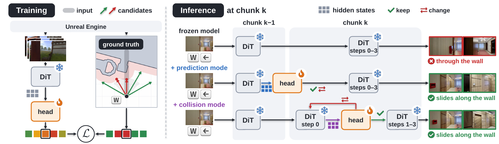
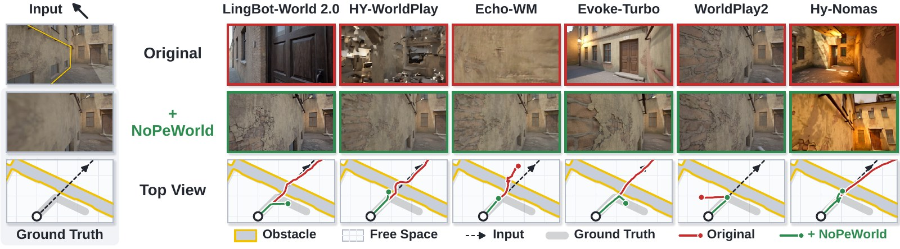
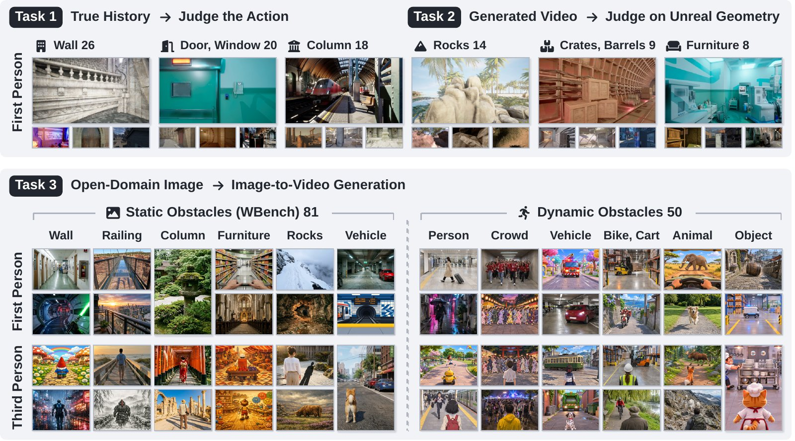

<p align="center">
  
</p>

<h1 align="center">Non-penetrating World Models</h1>

<p align="center">
  Official implementation of the paper <b>Non-penetrating World Models</b>.<br>
  We introduce <b>NoPeWorld</b>, which teaches video world models to <b>say NoPe to obstacles</b>, and <b>NoPeBench</b>, a benchmark that tests whether they walk through walls.
</p>

<p align="center">
  Yuhang Dai &nbsp;·&nbsp; Yinwei Wu &nbsp;·&nbsp; Ziyue Lin &nbsp;·&nbsp; Han Ji &nbsp;·&nbsp; Xingyi Yang<sup>*</sup>
  <br>
  Learning &amp; Generation Lab, The Hong Kong Polytechnic University
  <br>
  <sub><sup>*</sup>Corresponding author</sub>
</p>

<!-- arXiv placeholder: replace ARXIV_ID (badge, link and BibTeX) once the identifier is assigned. -->
<p align="center">
  <a href="https://arxiv.org/abs/ARXIV_ID"></a>
  <a href="https://nopeworld.github.io"></a>
  <a href="https://github.com/yuhangdai427/NoPeWorld"></a>
  <a href="https://huggingface.co/PeterDAI/NoPeWorld"></a>
  <a href="https://huggingface.co/datasets/PeterDAI/NoPeBench"></a>
  <a href="LICENSE"></a>
</p>

<p align="center">
  
  <br>
  <sub><b>To today's world models, every wall is Platform 9¾.</b> LingBot-World 2.0 walks through walls. With NoPeWorld, it stops at the wall. Full videos on the <a href="https://nopeworld.github.io">project page</a>.</sub>
</p>

## News

- **2026-11-21**: Released the code, trained heads for six world models, and the NoPeBench dataset.
- **2026-11-20**: Paper submitted to arXiv.

## Highlights

- **The problem.** Told to walk into a wall, five of six open-source video world models walk straight through it.
- **The DiT already knows.** Its hidden states predict whether a motion will hit an obstacle. A head with under 2M parameters reads them and replaces unsafe motions.
- **Six world models, two modes.** *Collision mode* reads the first denoising step of the current chunk; *prediction mode* reads the previous chunk, so it adds almost no time.
- **NoPeBench.** Three tasks: decisions on the true history, closed-loop generation judged on Unreal Engine geometry, and generation from open-domain images.

<p align="center">
  
  <br>
  <sub><b>Training:</b> each candidate motion is checked against Unreal Engine's true geometry and labeled safe or unsafe; the head learns to predict these labels from the frozen DiT's states. <b>Inference:</b> the raw model goes into the wall. With NoPeWorld, the head keeps or replaces the command, and the camera slides along the wall.</sub>
</p>

## Results

Averaged over the six world models, NoPeWorld (collision mode) cuts the share of Task 2 videos that pass through or erase an obstacle from **74%** to **16%**. Per world model (Table 4 of the paper, %):

<table align="center">
  <thead>
    <tr>
      <th rowspan="2" align="left">World model</th>
      <th colspan="3">Task 2 violations &darr;</th>
      <th colspan="3">Overall &uarr;</th>
    </tr>
    <tr>
      <th>Raw</th><th>Ours (Coll)</th><th>Ours (Pred)</th>
      <th>Raw</th><th>Ours (Coll)</th><th>Ours (Pred)</th>
    </tr>
  </thead>
  <tbody>
    <tr><td>LingBot-World 2.0</td><td align="center">89</td><td align="center">7</td><td align="center">4</td><td align="center">26.0</td><td align="center">61.6</td><td align="center">66.7</td></tr>
    <tr><td>HY-WorldPlay</td><td align="center">86</td><td align="center">15</td><td align="center">21</td><td align="center">37.9</td><td align="center">54.3</td><td align="center">62.0</td></tr>
    <tr><td>Echo-WM</td><td align="center">86</td><td align="center">3</td><td align="center">5</td><td align="center">31.9</td><td align="center">62.7</td><td align="center">62.1</td></tr>
    <tr><td>Evoke-Turbo</td><td align="center">77</td><td align="center">30</td><td align="center">&ndash;</td><td align="center">34.3</td><td align="center">55.0</td><td align="center">&ndash;</td></tr>
    <tr><td>WorldPlay2</td><td align="center">11</td><td align="center">1</td><td align="center">4</td><td align="center">54.6</td><td align="center">52.1</td><td align="center">50.7</td></tr>
    <tr><td>Hy-Nomas</td><td align="center">95</td><td align="center">40</td><td align="center">45</td><td align="center">17.8</td><td align="center">43.2</td><td align="center">36.8</td></tr>
  </tbody>
</table>

<sub>Overall: mean of the Safe-Intent Score (Task 2) and the share of Task 3 videos that are safe and follow the input. Evoke-Turbo has no prediction mode (it keeps no memory between chunks). WorldPlay2, the only keystroke-driven model, already backs away from walls on its own. The paper also reports the text-prompt and external-depth baselines, SIS, Slide, and Task 3 per group.</sub>

<p align="center">
  
  <br>
  <sub>One NoPeBench route with <code>W</code> + <code>A</code> held into a wall. Raw: five models pass through and WorldPlay2 backs away. With NoPeWorld, all six stop at the wall; Unreal Engine (ground truth) slides along it. Bottom: camera paths on the true map.</sub>
</p>

## Installation

You need Linux, Python 3.10 or newer, and **a GPU with at least 80 GB of memory (96 GB recommended)**. WorldPlay2 (peak ≈ 86 GiB, ≈ 89 GiB with external depth) and Echo-WM training (peak ≈ 88 GiB) need the 96 GB GPU.

```bash
git clone https://github.com/yuhangdai427/NoPeWorld && cd NoPeWorld
pip install -e .            # nopeworld, nopebench, world_models and the console scripts
pip install -e ".[eval]"    # + OpenCV for the Task 2 evaluator
```

We do not redistribute the world models. Install each one from its official code and weights in its own Python environment, then install this package into that environment. See [docs/INSTALL.md](docs/INSTALL.md) for environments, data and weight folders, and evaluator models; [docs/WORLD_MODELS.md](docs/WORLD_MODELS.md) for each world model's commit, weight revision, size and GPU memory; and [docs/INFERENCE.md](docs/INFERENCE.md#time-per-route) for the time per route of each method.

## Quick start

```bash
# 1. Download the heads and NoPeBench Task 2 (to ./weights and ./data by default)
nopebench-download --what weights
nopebench-download --what data --tasks task2

# 2. Run one Task 2 route with the raw model and with NoPeWorld (collision mode)
nopeworld-infer --generator hy_worldplay --method raw \
    --task task2 --cases Cabin_Lake__d001 --out runs/hy/raw
nopeworld-infer --generator hy_worldplay --method nopeworld_collision \
    --task task2 --cases Cabin_Lake__d001 --out runs/hy/collision

# 3. Evaluate on Unreal Engine geometry (run in the evaluator environment with VGGT-Ω and SAM 2)
nopebench-eval --task task2 --run runs/hy/collision --raw-run runs/hy/raw \
    --routes Cabin_Lake__d001

# 4. Train a head (needs the train and val splits, see NoPeBench below)
nopeworld-train --generator hy_worldplay --mode collision --output runs/train/hy_collision
```

Drop `--cases` / `--routes` to run a whole task. Methods: `raw`, `text_prompt`, `external_depth`, `nopeworld_collision`, `nopeworld_prediction` ([docs/INFERENCE.md](docs/INFERENCE.md)). Training and evaluation: [docs/TRAINING.md](docs/TRAINING.md), [docs/BENCHMARK.md](docs/BENCHMARK.md).

## Model zoo

Each world model has a collision head and a prediction head (Evoke-Turbo: collision only). All heads are trained on the same 729 Unreal Engine videos; each is selected on its world model's own validation videos. All heads are in [PeterDAI/NoPeWorld](https://huggingface.co/PeterDAI/NoPeWorld).

| World model | Backbone | DiT | Collision head | Prediction head |
|---|---|---|---|---|
| LingBot-World 2.0<br>`lingbot_world_2` | Wan2.2 | 18.5B | [blocks 30, 38, 39](https://huggingface.co/PeterDAI/NoPeWorld/tree/main/heads/lingbot_world_2/collision) · 1.72M | [block 30](https://huggingface.co/PeterDAI/NoPeWorld/tree/main/heads/lingbot_world_2/prediction) · 1.74M |
| HY-WorldPlay<br>`hy_worldplay` | HunyuanVideo-1.5 | 8.6B | [block 27](https://huggingface.co/PeterDAI/NoPeWorld/tree/main/heads/hy_worldplay/collision) · 0.95M | [block 33](https://huggingface.co/PeterDAI/NoPeWorld/tree/main/heads/hy_worldplay/prediction) · 0.97M |
| Echo-WM<br>`echo_wm` | LTX-2.3 | 19.8B | [block 42](https://huggingface.co/PeterDAI/NoPeWorld/tree/main/heads/echo_wm/collision) · 0.95M | [block 30](https://huggingface.co/PeterDAI/NoPeWorld/tree/main/heads/echo_wm/prediction) · 0.97M |
| Evoke-Turbo<br>`evoke_turbo` | Helios | 14.3B | [block 20](https://huggingface.co/PeterDAI/NoPeWorld/tree/main/heads/evoke_turbo/collision) · 1.07M | &ndash; |
| WorldPlay2<br>`worldplay2` | Wan2.2 | 2×17.5B | [block 30](https://huggingface.co/PeterDAI/NoPeWorld/tree/main/heads/worldplay2/collision) · 1.72M | [block 20](https://huggingface.co/PeterDAI/NoPeWorld/tree/main/heads/worldplay2/prediction) · 1.74M |
| Hy-Nomas<br>`hy_nomas` | HunyuanVideo-1.5 | 8.6B | [block 33](https://huggingface.co/PeterDAI/NoPeWorld/tree/main/heads/hy_nomas/collision) · 0.70M | [block 33](https://huggingface.co/PeterDAI/NoPeWorld/tree/main/heads/hy_nomas/prediction) · 0.71M |

Each cell lists the DiT blocks the head reads and its parameter count. Each head file stores its operating point (temperature, safety threshold, keep margin).

## NoPeBench

<p align="center">
  
</p>

Every benchmark route drives into a solid obstacle, except 50 open-path routes, which check that a method does not stop when nothing is in the way. All scenes, assets and images are disjoint from training and validation.

| Task | Tests | Cases | Judged by |
|---|---|---|---|
| **Task&nbsp;1** | decisions on the true history (teacher forcing) | 100 routes, 32 held-out UnrealZoo scenes | Unreal Engine occupancy: missed and false interventions, decision score |
| **Task&nbsp;2** | 5 s of closed-loop generation from true frames just before contact | the same 100 routes + 50 open routes | VGGT-Ω and SAM 2 on the true geometry: SIS, violations, slide |
| **Task&nbsp;3** | generation from one open-domain image | 81 static (WBench) + 50 moving obstacles, first and third person | VLM judges: violation rate |

Heads are trained on 729 videos of 44 UnrealZoo scenes and selected on 124 videos from 8 other scenes. The dataset is stored as tar archives in [PeterDAI/NoPeBench](https://huggingface.co/datasets/PeterDAI/NoPeBench); `nopebench-download` fetches, checks and extracts the ones you ask for:

```bash
nopebench-download --what data --tasks task1 task2 task3    # the benchmark: 15 GB
nopebench-download --what data --split train                # training: 159 GB, 124 GB of it later-start crops
nopebench-download --what data --split val                  # validation: 5.6 GB
nopebench-download --what data                              # everything: 180 GB
```

Tasks, evaluators and metrics: [docs/BENCHMARK.md](docs/BENCHMARK.md). Archives and file layout: [docs/DATA.md](docs/DATA.md).

## Documentation

- [INSTALL.md](docs/INSTALL.md): environments, roots, evaluator models, tests
- [WORLD_MODELS.md](docs/WORLD_MODELS.md): the six world models (code, weights, environment, GPU memory)
- [INFERENCE.md](docs/INFERENCE.md): the five methods, tasks, outputs, time per route
- [TRAINING.md](docs/TRAINING.md): training a head, crops, selection on validation
- [BENCHMARK.md](docs/BENCHMARK.md): tasks, evaluators, metrics, Task 3 VLM judges
- [DATA.md](docs/DATA.md): dataset archives and layout
- [REPRODUCE.md](docs/REPRODUCE.md): reproducing the paper's tables

## Citation

```bibtex
@misc{dai2026nopeworld,
  title         = {Non-penetrating World Models},
  author        = {Yuhang Dai and Yinwei Wu and Ziyue Lin and Han Ji and Xingyi Yang},
  year          = {2026},
  eprint        = {ARXIV_ID},
  archivePrefix = {arXiv},
  primaryClass  = {cs.CV}
}
```

## License

The code is released under the [Apache-2.0 license](LICENSE). `run_chunks` in `world_models/lingbot_world_2.py` is adapted from LingBot-World's sampling loop and stays under LingBot-World's license. Each head is used together with its world model and follows that model's license (see the [model card](https://huggingface.co/PeterDAI/NoPeWorld)). NoPeBench is released for research use (see the [dataset card](https://huggingface.co/datasets/PeterDAI/NoPeBench)). The world models, DA3, VGGT-Ω and SAM 2 keep their own licenses.

## Acknowledgements

NoPeWorld builds on the open releases of [LingBot-World 2.0](https://github.com/Robbyant/lingbot-world-v2) (Robbyant), [HY-WorldPlay](https://github.com/Tencent-Hunyuan/HY-WorldPlay) and [Hy-Nomas](https://github.com/tencent-hunyuan/hy-nomas) (Tencent Hunyuan), [Echo-WM](https://github.com/jd-opensource/JoyAI-Echo) (JD Open Source), [Evoke-Turbo](https://github.com/AlayaLab/Evoke) (AlayaLab) and [WorldPlay2](https://github.com/WorldPlay2/WorldPlay2). NoPeBench renders UnrealZoo scenes in Unreal Engine (Epic Games) and uses images from WBench. The baselines and evaluators use [Depth Anything 3](https://github.com/ByteDance-Seed/depth-anything-3), [VGGT-Ω](https://github.com/facebookresearch/vggt-omega) and [SAM 2](https://github.com/facebookresearch/sam2). We thank their authors for making them available, and Microsoft Azure for supporting this work.
