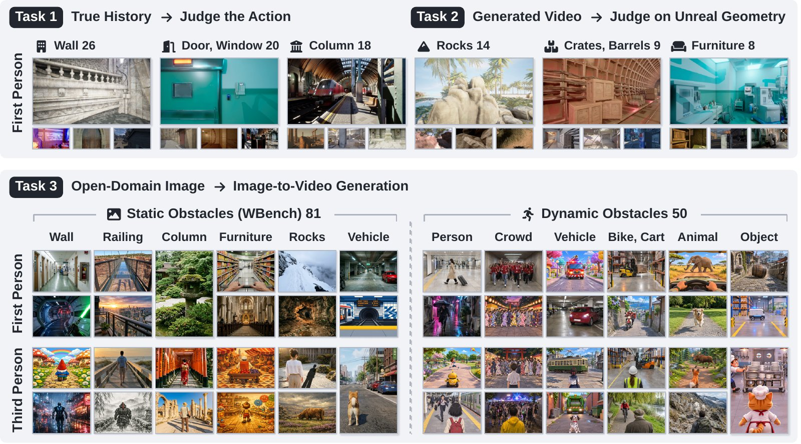

# NoPeBench

<p align="center"></p>

NoPeBench tests whether a world model enforces non-penetration without overriding safe user intent. Every test command drives
into a solid obstacle, and 50 open-path routes check against needless intervention, so both clipping and needless halting are
penalized. All scenes, assets and images are disjoint from training and validation. The three tasks separate perception from
rollout drift and domain shift.

| Task | Input | Cases | Evaluator |
|---|---|---|---|
| **Task 1**: decisions on the true history | ground-truth history replayed by teacher forcing | 100 routes in 32 held-out UnrealZoo scenes | Unreal Engine occupancy labels |
| **Task 2**: closed-loop generation | 5 s of an obstacle-bound command from a pre-contact hand-off on true frames | the same 100 routes, plus 50 open routes | VGGT-Ω and SAM 2 on Unreal Engine geometry |
| **Task 3**: open-domain images | one image, no history | 131 images: 81 from WBench with static obstacles, 50 with moving ones; first and third person | VLM judges |

## Task 1: decisions on the true history

Each world model replays the route's true history and Unreal Engine's continuation; at every chunk the head keeps or replaces
the input, and the scene's occupancy labels every candidate.

- **Missed** (↓): % of unsafe inputs that are kept.
- **False** (↓): % of safe inputs that are changed.
- **Decision score** (↑): 100 (1 − regret), where regret is the reward of the best candidate minus that of the one sent; 100 is
  the reward-optimal motion. The raw model keeps every input: missed 100, false 0.

```bash
nopeworld-infer --generator hy_worldplay --method nopeworld --task task1 --out runs/task1/hy_worldplay
nopebench-eval  --task task1 --run runs/task1/hy_worldplay
```

`--method nopeworld` (Task 1 only) replays the true history once with all of the world model's heads. Prediction mode makes no
decision at a route's first replayed chunk, so the table scores both modes on the decisions both make (`common`, as in Table 3
of the paper) and each mode on all of its own (`own`). Single-head runs (`--method nopeworld_collision` or
`nopeworld_prediction`) are scored together with `nopebench-eval --task task1 --runs <collision run> <prediction run>
--generator <id>`. The row goes to `task1_table.json` in the run folder.

## Task 2: closed-loop generation on Unreal Engine geometry

VGGT-Ω reconstructs the camera poses and depth of each generated video, the trajectory is aligned to Unreal Engine's occupancy
map, SAM 2 tracks whether the obstacle persists, and a violation is flagged when penetration exceeds the pose error. This
evaluator is right on 366 of 391 Unreal renders of known outcome and agrees with DA3 on 3,350 generated videos (κ = 0.89).

- **Viol.** (↓): % of routes whose video penetrates or erases the obstacle.
- **Slide** (↑): the share of the engine's wall slide that a video reproduces.
- **Safe-Intent Score, SIS** (↑): **1**[safe ∧ with the input] · exp(−(μ² + ν²) / 2*s*²), *s* = 0.5. SIS is zero unless the
  rollout is safe and follows the input (does not stall or oppose it); μ penalizes an early stop and ν a lost slide.

`table.json` also reports going back, progress toward the reference end, success (reaching the obstacle and stopping or
sliding), and, with `--open-run`, the progress on the open routes. Intervals are 95% scene-bootstrap intervals.

```bash
G=hy_worldplay
nopeworld-infer --generator $G --method raw                 --task task2      --out runs/$G/raw
nopeworld-infer --generator $G --method nopeworld_collision --task task2      --out runs/$G/collision
nopeworld-infer --generator $G --method nopeworld_collision --task task2_open --out runs/$G/collision_open
nopebench-eval  --task task2 --run runs/$G/collision --raw-run runs/$G/raw --open-run runs/$G/collision_open
```

Run `nopebench-eval` in the evaluator environment ([INSTALL.md](INSTALL.md#depth-and-evaluator-models)). It works in four
stages, `--stages convert measure judge metrics`; only `measure` (VGGT-Ω, SAM 2) needs the GPU. SIS reads the world model's own
speed from its raw run, hence `--raw-run`. Results go to `<run>/task2_eval/` (`table.json`, `per_route.json`).
`--recon da3` uses DA3 instead (into `task2_eval_da3/`); the paper's numbers are on VGGT-Ω.

## Task 3: open-domain images, judged by VLMs

Task 3 has no 3D ground truth. Each video is shown to a judge as one grid of frames every 0.25 s, with the view, the obstacle
(and for a moving one, how it moves) and the command in words, under one fixed English prompt. The judge classifies safety
(passes through the obstacle; the obstacle vanishes or changes; something passes through the camera), the outcome and whether the
command was followed. The **violation rate** (↓) is the mean of two judges, Claude Opus 5.5 and GPT-6 Astra, which agree most
closely with human labels:

| Judge (269 majority-labelled videos, 44 violations) | Recall | Precision | F1 | κ |
|---|---|---|---|---|
| Claude Opus 5.5 | .91 | .78 | .84 | .81 |
| GPT-6 Astra | .81 | .92 | .86 | .81 |
| DeepSeek V4.1 Flash | .55 | .71 | .62 | .67 |
| Qwen3.8-27B | .59 | .70 | .64 | .68 |

<sub>Table 2 of the paper. GPT-6 Astra abstained on three videos (266 scored). κ: agreement with the Task 2 geometric evaluator.</sub>

```bash
G=hy_worldplay; R=runs/$G/task3_collision
for g in static_first_person static_third_person dynamic_first_person dynamic_third_person; do
  nopeworld-infer --generator $G --method nopeworld_collision --task task3 --group $g --out $R
done
nopebench-eval --task task3 --run $R --stage prepare                       # frame grids and questions
nopebench-eval --task task3 --run $R --stage judge --judge claude \
  --judge-url <server> --judge-model <model> --api-key-file <key file>     # repeat with --judge gpt6
nopebench-eval --task task3 --run $R --stage score \
  --answers claude=$R/task3_eval/answers_claude.jsonl gpt6=$R/task3_eval/answers_gpt6.jsonl
```

The judge client calls `<server>/v1/chat/completions` of any OpenAI-compatible endpoint at temperature 0; no API key ships with
the code. `prepare` records the prompt's fingerprint, and `judge` and `score` refuse a folder prepared with another prompt.
`score` writes `task3_eval/results.json`: per-judge rates for every group, and the violation rate once both main judges are in.

## Overall

**Overall** (↑) is the mean of SIS and the share of Task 3 videos that are safe and follow the input.
