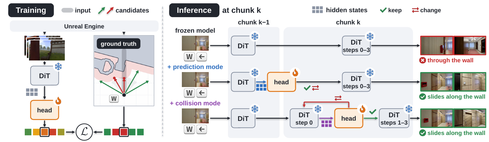

# Training

<p align="center"></p>

A head is trained on one frozen world model. The world model replays the training videos by teacher forcing; at every decision
state the head reads its hidden states and learns labels computed from Unreal Engine's true geometry. No world-model weight is
updated.

## The head

- **Input.** All tokens of the tapped DiT blocks, each mapped from the DiT width to 128 by a learned per-token projection (no
  pooling), plus the candidate motions, encoded by the world model's own frozen control encoder.
- **Body.** A learned query attends over the action-conditioned state tokens through two cross-attention blocks (4 heads, width 128).
- **Output, per candidate.** A safety logit, the swept clearance and an intent score.
- **Size.** 0.70M to 1.74M parameters, depending on the world model.

Where the head reads is set per world model and mode in `configs/world_models/<id>.yaml` (`heads.<mode>.blocks`; `state: step0`
is collision mode, `state: commit` is prediction mode).

## Labels

For each decision state, a collision disc (radius 0.25 m) is swept along each of the 34 candidate motions on the scene's
occupancy map. This gives each candidate a clipped clearance *g* and, against the collide-and-slide response to the input, an
intent error *ε*. The targets are a safety probability *P* = Φ((*g* − 0.05 m) / 0.03 m), an intent score *A* = exp(−*ε*² / 2*s*²)
with *s* = 0.5, and their product *R* = *P A*, which ranks candidates that are both safe and on intent. The labels are stored in
the training rows (`policy_target`, `collision_target`, `candidate_rim_clearance_m`, ...), so training needs no geometry.

The loss combines a BCE on safety, a Huber loss on clearance, a BCE on intent and a listwise KL term on the ranking (Eq. 5 of the
paper); chunk indices are reweighted so that unsafe rates are equal across them.

## Data

| what | where | archives |
|---|---|---|
| decision rows and replay order | `train/rows/<id>/rows.jsonl.gz`, `stream.json` | `train-rows.tar` |
| 729 training videos (509 episodes, 220 near-wall clips; 44 scenes) | `train/episodes/` | `train-episodes-*-of-00008.tar` |
| 1,527 later-start crops of them | `train/crops/` | `train-crops-*-of-00025.tar` |
| 124 validation videos and their rows (8 scenes) | `val/` | `val.tar` |

```bash
nopebench-download --what data --split train val
```

The crops are replayed by the HY-WorldPlay, Echo-WM, Evoke-Turbo and WorldPlay2 runs (`manifest/train/<id>.txt` lists what each
run replayed). Instead of downloading them, you can cut them from the episodes on the CPU (about 20 s a crop):

```bash
pip install -e ".[crops]"
python -m nopeworld.training.crops --generator hy_worldplay --workers 2
```

With the ffmpeg of `imageio-ffmpeg==0.6.0` on x86-64 Linux the files are byte for byte the crops the heads were trained on.

## Train

```bash
nopeworld-train --generator hy_worldplay --mode collision --output runs/train/hy_collision
nopeworld-train --generator worldplay2 --mode both --output runs/train/worldplay2      # both heads in one replay
```

| option | meaning |
|---|---|
| `--mode` | `collision`, `prediction` or `both` |
| `--max-steps` | optimizer steps (default: the world model's config) |
| `--limit-train`, `--limit-val` | only the first videos of the stream / of validation |
| `--no-validation-extra` | leave the near-wall validation clips out |
| `--no-select` | train only; do not fix the operating point |
| `--prefetch` | videos prepared ahead in a background thread |

Peak GPU memory of a short training run with both heads (`--mode both`, 20 optimizer steps), measured on one 96 GB GPU:

| LingBot-World 2.0 | HY-WorldPlay | Echo-WM | Evoke-Turbo | WorldPlay2 | Hy-Nomas |
|---|---|---|---|---|---|
| 69.4 GiB | 54.3 GiB | 87.5 GiB | 43.4 GiB | 56.8 GiB | 47.9 GiB |

The run folder gets `losses.jsonl` (every state's loss terms), `report.json`, `val_preds.pt` and
`heads/<id>/<mode>/head.pt` in the released format. Point `NOPE_WEIGHTS` at the run folder to use the new head. The training run
of each released head (videos, crops, decision states, optimizer steps) is recorded in its `config.json` on the
[model repository](https://huggingface.co/PeterDAI/NoPeWorld).

## Selection on validation

After training, the run fixes the head's operating point on validation videos of the same world model, in two steps:

1. the temperature *T* of the safety probability is fitted by soft-label negative log-likelihood;
2. among the (τ, δ) pairs whose missed-intervention rate is within the limit, the one with the lowest regret is kept.

The limit is 0.10, and 0.05 for Echo-WM's collision head and both WorldPlay2 heads (`missed_limit` in the world model's config).
Validation scenes are disjoint from the training and benchmark scenes; `manifest/val/<id>.txt` lists the videos each world
model's selection scored. The operating point is written into `head.pt`; inference reads it from there.
